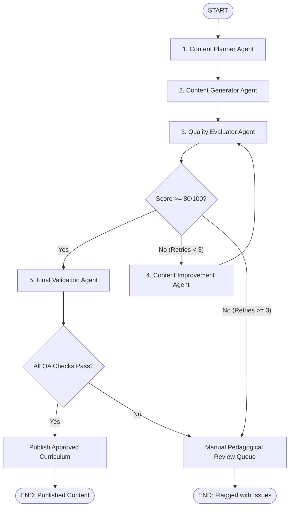

# Agentic AI Learning Content Generation and Self-Evaluation System

A production-grade, end-to-end Agentic AI application built with **FastAPI**, **LangGraph**, **Pydantic**, **SQLAlchemy**, and **React + TypeScript + Tailwind CSS**. The system automatically plans, drafts, fact-checks, scores, iteratively remediates, and validates educational curricula using specialized AI agents.

---

## 1. System Architecture & Multi-Agent Design

The platform coordinates five specialized AI agents managed by a compiled **LangGraph** finite-state machine:



### Specialized Agents

| Agent | Responsibility | Core Outputs |
| :--- | :--- | :--- |
| **1. Content Planner Agent** | Deconstructs user requirements, applies Bloom's Taxonomy, designs structured module outlines and evaluation rubrics. | `ContentPlan` (Outline, Objectives, Evaluation Criteria) |
| **2. Content Generator Agent** | Synthesizes pedagogical content, real-world examples, key terms, callouts, and practice questions. | `EducationalContentSchema` (JSON) |
| **3. Quality Evaluator Agent** | Independent auditor that calculates a weighted score across 6 dimensions, flags unsupported claims, and identifies concept omissions. | `EvaluationResult` (Scores, Errors, Missing Concepts, Recommendations) |
| **4. Content Improvement Agent** | Receives evaluation critique, targets only flawed sections, remedies inaccuracies, and records changelogs while preserving solid content. | `ImprovementResult` (Revised Content, Changelog) |
| **5. Final Validation Agent** | Performs compliance audit against user goals, verifying consistency and schema completeness before authoring publication release. | `FinalValidationResult` (Approval Decision, Confidence Score) |

---

## 2. Evaluation Dimensions & Scoring Formula

Content is never blindly rubber-stamped. The Quality Evaluator Agent computes an overall score from 0 to 100 based on the following weighted dimensions:

$$\text{Overall Score} = (0.25 \times \text{Factual Accuracy}) + (0.20 \times \text{Relevance}) + (0.20 \times \text{Completeness}) + (0.15 \times \text{Clarity \& Readability}) + (0.10 \times \text{Educational Effectiveness}) + (0.10 \times \text{Structure \& Organization})$$

- **Default Passing Threshold:** $\ge 80.0 / 100$ (configurable in Settings).
- **Remediation Loop Limit:** Up to 3 improvement passes.
- **Safety Gate:** If content does not reach $\ge 80.0$ after 3 passes, it is flagged for manual review with its unresolved issues rather than falsely approved.

---

## 3. Technology Stack

- **Backend:** Python 3.12+, FastAPI, LangGraph, LangChain, Pydantic v2, SQLAlchemy ORM, SQLite.
- **AI Providers:** Configurable dynamic provider architecture supporting:
  - **Mock AI Provider:** Zero-cost deterministic pedagogical engine with realistic evaluation and refinement loops.
  - **OpenAI API:** GPT-4o with native structured outputs.
  - **Google Gemini API:** Gemini 1.5 Pro.
- **Frontend:** React 18, TypeScript, Tailwind CSS, Lucide Icons, Recharts for analytics and dimensional radar/bar charts.
- **Testing:** Pytest, pytest-asyncio, FastAPI TestClient.

---

## 4. Project Directory Structure

```
agentic-learning-system/
├── backend/
│   ├── app/
│   │   ├── config.py              # Pydantic Settings & environment variables
│   │   ├── database.py            # SQLite engine & session management
│   │   ├── models.py              # SQLAlchemy database models (5 tables)
│   │   ├── schemas.py             # Pydantic validation schemas
│   │   ├── main.py                # FastAPI entry point & CORS
│   │   ├── agents/
│   │   │   ├── state.py           # LangGraph AgentWorkflowState
│   │   │   ├── prompts.py         # Specialized agent prompt templates
│   │   │   ├── planner.py         # Agent 1: Planner
│   │   │   ├── generator.py       # Agent 2: Generator
│   │   │   ├── evaluator.py       # Agent 3: Evaluator
│   │   │   ├── improver.py        # Agent 4: Improver
│   │   │   ├── validator.py       # Agent 5: Validator
│   │   │   └── workflow.py        # LangGraph StateGraph & conditional edges
│   │   ├── providers/
│   │   │   ├── base.py            # Base provider interface
│   │   │   ├── mock_provider.py   # Realistic simulation & evaluation provider
│   │   │   ├── openai_provider.py # OpenAI GPT integration
│   │   │   ├── gemini_provider.py # Google Gemini integration
│   │   │   └── factory.py         # Dynamic provider switcher
│   │   ├── api/
│   │   │   ├── routes_content.py  # Content generation, list, detail, history
│   │   │   ├── routes_workflow.py # Real-time status & SSE streaming
│   │   │   ├── routes_analytics.py# Platform metrics & dimension averages
│   │   │   └── routes_settings.py # Provider & threshold settings
│   │   └── utils/
│   │       ├── markdown_export.py # Markdown compilation & styling
│   │       └── seed_data.py       # Sample educational seed modules
│   ├── tests/
│   │   ├── test_agents.py         # Unit tests for individual agents
│   │   ├── test_workflow.py       # End-to-end LangGraph state machine test
│   │   └── test_api.py            # FastAPI integration tests
│   ├── requirements.txt
│   └── pytest.ini
├── frontend/
│   ├── src/
│   │   ├── components/            # ScoreGauge, DimensionChart, AgentTimeline, ContentViewer
│   │   ├── pages/                 # Dashboard, CreateContent, LiveWorkflow, EvaluationReport, GeneratedContentPage, SettingsPage
│   │   ├── services/api.ts        # Typed API service
│   │   ├── types/index.ts         # TypeScript interfaces
│   │   ├── App.tsx
│   │   └── main.tsx
│   ├── package.json
│   ├── tailwind.config.js
│   └── vite.config.ts
├── run.bat                        # One-click Windows runner
├── run.sh                         # Linux / macOS runner
└── README.md
```

---

## 5. REST API Endpoints

| Method | Endpoint | Description |
| :--- | :--- | :--- |
| `POST` | `/api/content/generate` | Launch asynchronous multi-agent generation workflow. |
| `GET` | `/api/content` | List generated curricula with filters and pagination. |
| `GET` | `/api/content/{id}` | Detailed content reader with raw JSON and Markdown. |
| `GET` | `/api/content/{id}/evaluation` | All evaluation iterations and dimension score breakdowns. |
| `GET` | `/api/content/{id}/history` | Remediation changelog and score delta history. |
| `GET` | `/api/workflow/{id}/status` | Real-time agent status, active node, retries, and logs. |
| `GET` | `/api/workflow/{id}/stream` | Server-Sent Events (SSE) stream for live UI updates. |
| `GET` | `/api/analytics` | Overall pass rates, averages, and score distributions. |
| `GET` | `/api/settings` | Current provider and credential statuses (safe mask). |
| `POST` | `/api/settings` | Update active provider, models, and quality threshold. |
| `GET` | `/api/health` | Service health status. |

---

## 6. Windows Execution Guide

### Prerequisites
- Python 3.11 or 3.12 (installed at `C:\Users\Kishore\AppData\Local\Programs\Python\Python312`)
- Node.js v18+ and npm

### Quick Start (One-Click)
Double-click `run.bat` or run:
```cmd
cd C:\Users\Kishore\.gemini\antigravity\scratch\agentic-learning-system
run.bat
```

### Manual Run

#### 1. Start the FastAPI Backend
```powershell
cd C:\Users\Kishore\.gemini\antigravity\scratch\agentic-learning-system\backend
$env:PYTHONPATH = "C:\Users\Kishore\.gemini\antigravity\scratch\agentic-learning-system\backend"
& "C:\Users\Kishore\AppData\Local\Programs\Python\Python312\python.exe" -m uvicorn app.main:app --host 127.0.0.1 --port 8000 --reload
```
API Documentation will be accessible at: `http://127.0.0.1:8000/docs`

#### 2. Start the React Frontend
In a separate terminal:
```powershell
cd C:\Users\Kishore\.gemini\antigravity\scratch\agentic-learning-system\frontend
npm run dev
```
Dashboard will be accessible at: `http://127.0.0.1:5173`

#### 3. Run the Automated Test Suite
```powershell
cd C:\Users\Kishore\.gemini\antigravity\scratch\agentic-learning-system\backend
$env:PYTHONPATH = "C:\Users\Kishore\.gemini\antigravity\scratch\agentic-learning-system\backend"
& "C:\Users\Kishore\AppData\Local\Programs\Python\Python312\python.exe" -m pytest -v
```

---

## 7. Configuration & Model Switching

Configure credentials in `backend/.env`:
```env
# Provider: "mock", "openai", or "google"
LLM_PROVIDER=mock

# Optional live provider keys
OPENAI_API_KEY=sk-...
GEMINI_API_KEY=AIza...

# Models
OPENAI_MODEL=gpt-4o
GEMINI_MODEL=gemini-1.5-pro

# Quality Threshold & Retry Limits
DEFAULT_QUALITY_THRESHOLD=80.0
MAX_IMPROVEMENT_ATTEMPTS=3
```
You can also change the active provider dynamically through the **Settings** view in the UI without restarting the server.

